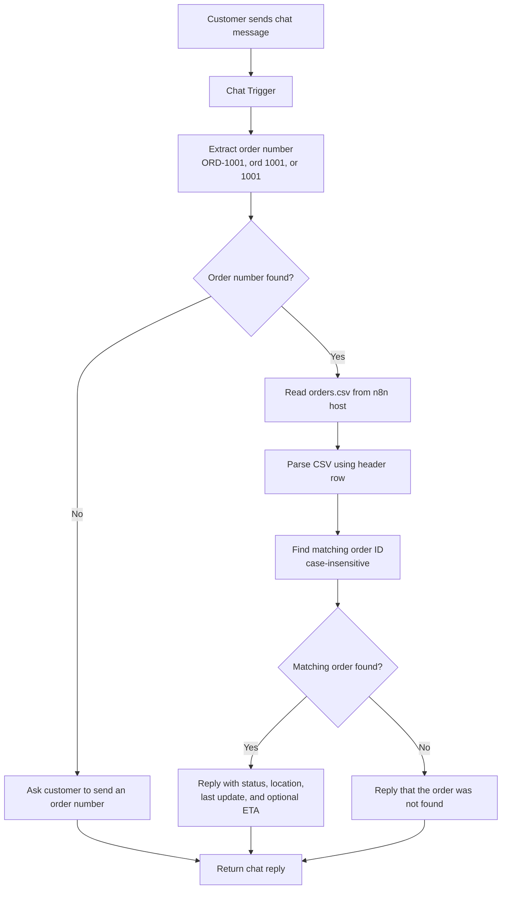

# Order Tracking Chatbot

An n8n chat workflow that extracts an order number from a message, looks it up in a CSV file, and replies with the latest tracking details.

## Workflow illustration



## How it works

1. The Chat Trigger receives the customer's message.
2. Parse Order ID extracts a sequence of at least four digits, with an optional `ORD` prefix and hyphen or space, then normalizes it to `ORD-<digits>`. For example, `ord 1001`, `ORD-1001`, and `1001` all become `ORD-1001`.
3. If no number can be extracted, the workflow asks the customer to provide one.
4. Otherwise, n8n reads and parses the orders CSV, then compares the normalized ID with the `order_id` column without case sensitivity.
5. A match returns the order ID, customer name when present, status, current location, last update, and ETA when available. No match returns a not-found message.

## Orders file

The workflow reads this path on the n8n host:

```text
/home/node/.n8n-files/orders.csv
```

Create that file in the n8n runtime environment and make sure the n8n file-access policy allows the workflow to read it. The first CSV row must contain headers. Required columns are `order_id`, `status`, `current_location`, and `last_updated`. `customer_name` and `eta` are optional.

Example:

```csv
order_id,customer_name,status,current_location,last_updated,eta
ORD-1001,Taylor Example,In transit,Chicago IL,2026-10-26 14:30,2026-10-29
ORD-1002,Jordan Example,Label created,Los Angeles CA,2026-10-27 09:15,2026-10-31
```

## Import and test

1. Import [order-tracking-chatbot-workflow.json](order-tracking-chatbot-workflow.json) into n8n.
2. Create the CSV at the path above, or edit the `Read Orders File` node to use your own permitted path.
3. Test the workflow in n8n and send `ORD-1001` or `1001` in the chat.
4. Send a message without a four-digit order number to test the prompt branch, and send an unknown number such as `ORD-9999` to test the not-found reply.

The chat trigger is configured as public. Do not expose real order data through an unauthenticated chat based only on guessable order numbers; add customer verification and appropriate access controls before using real customer information.
